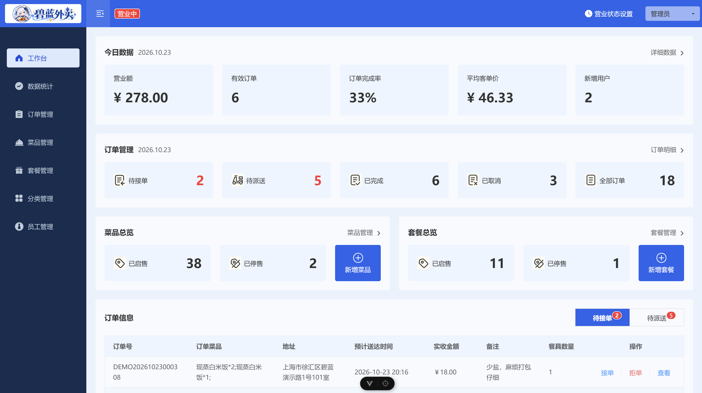
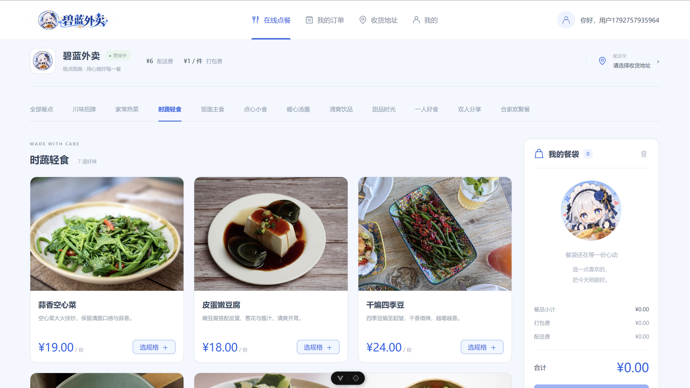

# 碧蓝外卖(azure-take-out) —— 基于《苍穹外卖》二次开发的外卖演示平台


## 📖 项目简介

本项目源自于黑马程序员的《苍穹外卖》教学项目。

原项目是一个业务闭环的外卖平台，能够实现**用户登录->加入购物车->下单->支付->商家接单->骑手配送->订单完成**的完整业务流程。

- [原始代码](https://github.com/smith-gala/2026-source-code)
- [b站课程视频](https://www.bilibili.com/video/BV1TP411v7v6/?spm_id_from=333.337.search-card.all.click)

本项目在原项目的基础上进行了整理，升级与二次开发。

## ✨ 项目亮点

- 修复了原项目中的若干 bug，如缺少事务注解，购物车与菜品/套餐信息不同步等
- 将原项目的 SpringBoot 从 2.7.3 升级到了 3.5.16，JDK 从 8 升级到了 21,相关依赖版本做了配套升级
- 将 JJWT,FastJson,POI,MD5 等过于老旧的组件或不安全的算法进行了升级或替换
- 将管理端前端升级为 Vue 3、Vite、Element Plus 和 Pinia，制作了新的 logo 和背景图
- 将用户端前端用 Vue3 重写为网页，解决原版必须注册微信小程序账号才能使用的痛点
- 将缓存操作进行了封装，使用 Redisson 的互斥锁，缓存控制以及抖动 TTL 的方式来解决缓存击穿、缓存穿透和缓存雪崩问题，为分类列表也加了缓存，性能显著提升。

## 🖼 图片展示

### 管理端工作台



### 用户端在线点餐



## 🚀 功能介绍

项目包含管理端和用户端，覆盖店铺运营、在线点餐和订单处理等外卖平台功能。

### 管理端

- **登录与退出**：使用员工账号登录管理后台，支持退出登录。
- **员工管理**：编辑和查询员工信息；仅 `admin` 可新增、启用或禁用员工，且不能禁用自己。
- **分类管理**：管理菜品与套餐分类，支持新增、修改、删除、查询及启用、禁用。
- **菜品管理**：维护菜品名称、价格、图片和口味，支持新增、修改、查询、批量删除及起售、停售。
- **套餐管理**：组合菜品创建套餐，维护套餐信息，支持新增、修改、查询、删除及起售、停售。
- **店铺管理**：查看并设置店铺的营业、打烊状态。
- **订单管理**：按条件和状态查询订单、查看订单详情，执行接单、拒单、取消、派送和完成操作；系统自动取消超时未支付订单，并定时处理派送中的订单。
- **工作台**：查看今日营业额、有效订单数、订单完成率、平均客单价和新增用户，以及订单、菜品和套餐的状态概览。
- **数据统计与报表**：按日期范围统计营业额、用户数量、订单数量与完成率，查看销量前十的菜品，并导出运营数据 Excel 报表。
- **实时提醒**：接收新订单和客户催单消息，通过弹窗及语音提醒商家处理。

### 用户端

- **登录，注册与退出**：用户可以注册账号，使用账号密码登录，支持退出登录。
- **个人资料管理**：支持用户编辑头像，昵称，性别，手机号等个人资料，支持修改密码。
- **地址管理**：新增、修改、删除和查询收货地址，设置默认地址。
- **订单查询**：查看历史订单，按订单状态筛选，查看订单明细和处理状态。
- **订单操作**：取消尚未接单的订单、向商家催单，或通过“再来一单”将原订单商品加入购物车。
- **浏览商品**：查看店铺营业状态，按分类浏览菜品和套餐，查看价格、菜品口味及套餐包含的菜品。
- **购物车**：将菜品或套餐加入购物车，选择口味、调整数量，查看或清空购物车。
- **下单与支付**：选择收货地址、配送时间和餐具数量，填写订单备注，提交订单并完成支付（当前使用模拟支付）。

## 🛠 技术栈

| 模块 | 技术 | 端口 |
| --- | --- | --- |
| 后端 | JDK21、Spring Boot 3.5.16、MyBatis、Druid、Redis、WebSocket、JWT、POI、Knife4j | 8080 |
| 管理端前端 | Vue 3 + TypeScript + Vite + Element Plus + Pinia | 5173（dev server） |
| 用户端前端 | Vue 3 + TypeScript + Vite + Element Plus + Pinia | 5174（dev server） |
| 数据库 | MySQL 8，库名 `azure_take_out` | 3306 |
| 缓存 | Redis，`database` 为 **0** | 6379 |

## ⚡ 快速开始

### 环境信息

| 环境/工具 | 版本或说明 |
| --- | --- |
| 操作系统 | Windows + WSL2(Ubuntu26.04) |
| JDK | 21 |
| Maven | 3.9.12 |
| MySQL | 8.4.11 |
| Redis | 8.0.5 |

### 1. 初始化数据库

```bash
mysql -u用户名 -p < db/azure.sql
```

脚本使用 `azure_take_out` 数据库，会重建 11 张业务表并写入演示数据。项目改名后无需迁移旧库。

菜品与套餐的 52 张演示图片位于 [`assets/initImage`](assets/initImage/)，Maven 构建时自动打包到 `classpath:/menu-images/`，无需手动复制。SQL 中的图片地址默认使用 `http://localhost:8080/menu-images/`；调整后端访问地址时，需同步修改 SQL 中的图片 URL。

### 2. 启动 Redis

```bash
sudo systemctl start redis
```

后端连接的 `database` 是 **0**，确认本地 Redis 已启动且该库可用。

全新 Redis 中店铺默认打烊；需要演示下单时，启动两端后先在管理端将店铺切换为营业中。

重新导入演示数据或从旧版本升级时，需要删除本项目的商品缓存 `dish_*`、`setmealCache::*`、`setmealDishCache::*`，避免展示旧商品或旧缓存中的 Java 包名导致反序列化失败；保留 `SHOP_STATUS` 等非商品数据。

### 3. 启动后端

先把 `azure-take-out/azure-server/src/main/resources/application-local.example.yml` 复制为同目录的 `application-local.yml`。后端默认启用 `local` 配置；`application-local.yml` 已加入 `.gitignore`。

在 `application-local.yml` 中填写：

| 配置项 | 说明 |
| --- | --- |
| `azure.datasource.host / port / database / username / password` | 本机 MySQL 地址、端口、库名（默认 `azure_take_out`）、用户名和密码 |
| `azure.redis.host / port / database` | Redis 地址、端口和库编号（默认 `0`） |
| `azure.upload-path` | 上传图片的保存目录，确保后端进程可写；相对路径以启动后端时的工作目录为准 |
| `azure.jwt` | 服务器密钥，可以用 `openssl rand -base64 32` 生成 |

上传目录以 `azure.upload-path` 为根目录，管理端图片保存到 `admin/`，用户头像保存到 `user/`；上传时会自动创建对应子目录。

用户端使用账号密码登录。项目当前支付流程使用模拟支付成功，无需配置第三方支付商户号或证书。

然后运行 `azure-take-out/azure-server` 下的 `com.azure.AzureApplication`，服务端口 **8080**。

可以从 http://localhost:8080/doc.html 查看后端接口文档

### 4. 启动管理端前端

需要 Node.js `^22.22.2 || ^24.15.0 || >=26.0.0`。

```bash
cd admin-frontend
npm ci
npm run dev
```

开发服务固定使用 http://localhost:5173，端口被占用时直接报错。

### 5. 启动用户端前端

需要 Node.js `^22.22.2 || ^24.15.0 || >=26.0.0`。

```bash
cd user-frontend
npm ci
npm run dev
```

开发服务固定使用 http://localhost:5174，端口被占用时直接报错。

### 默认账号

| 端 | 账号 | 密码 |
| --- | --- | --- |
| 管理端 | `admin` | `123456` |
| 用户端 | `demo01` | `123456` |

## 📂 项目结构

以下展示主要源码、资源与测试目录。

```text
azure-take-out/
├── assets/
│   ├── images/                                # README 中的管理端与用户端演示截图
│   └── initImage/                             # 随后端构建打包的菜品与套餐图片
├── azure-take-out/                            # 后端（Maven 多模块）
├── admin-frontend/                            # 管理端前端(Vue3)
├── user-frontend/                             # 用户端前端(Vue3)
├── db/
│   ├── azure.sql                              # 建库建表与初始数据，默认密码使用 Argon2id 哈希
│   └── 数据库设计文档.md
├── .gitignore                                 # 构建产物、本地配置等忽略规则
└── README.md                                  # 项目说明与运行指南
```

模块文档：

- [后端 README](azure-take-out/README.md)：主要技术栈、模块划分与目录职责。
- [管理端前端 README](admin-frontend/README.md)：主要技术栈、目录结构及运行、测试与部署说明。
- [用户端前端 README](user-frontend/README.md)：主要技术栈、目录结构及运行、测试与部署说明。

## 🗄 数据库设计

见 `db/数据库设计文档.md`。

## 🗺 后续计划

- 实现优惠券模块，包括商家发布优惠券，用户领取优惠券，下单时使用优惠券。
- 实现对于每个菜品的用户评价功能
